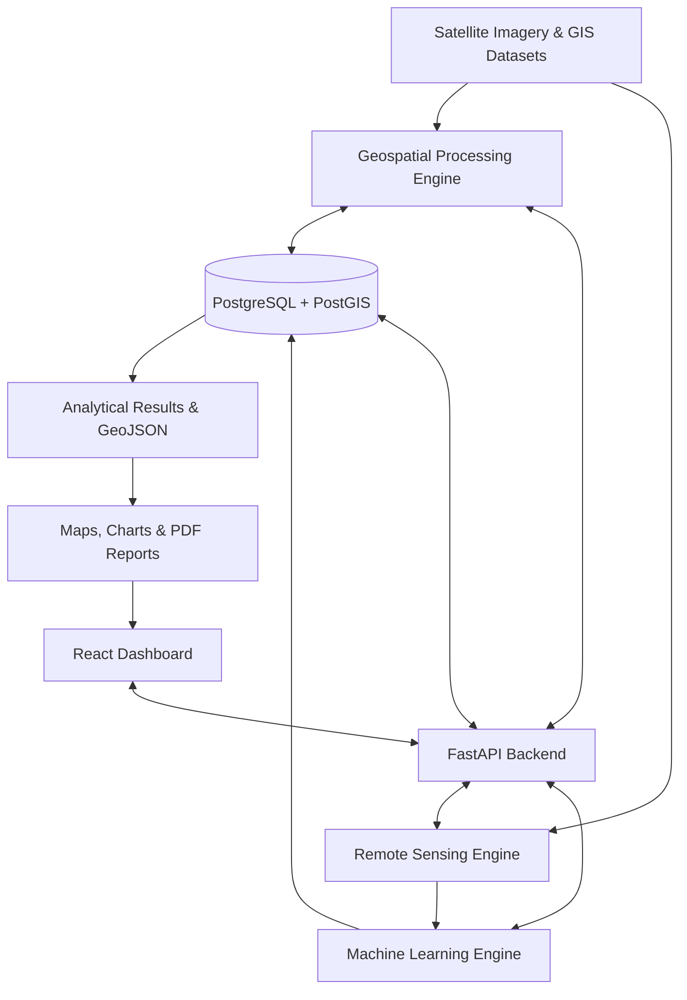
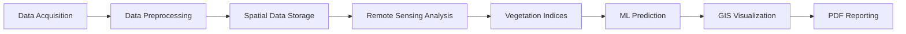
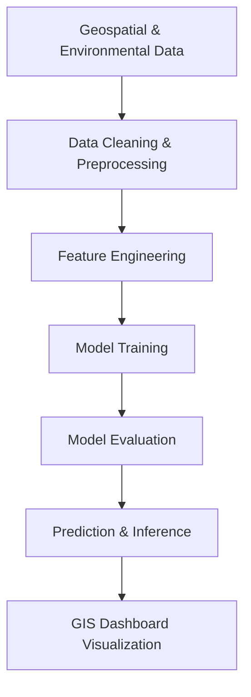

# 🌍 GeoAgri Intelligence
### AI-Powered Agricultural Monitoring, GIS & Remote Sensing Platform

<p align="center">

**Turning Geospatial Data into Agricultural Intelligence.**

An integrated GIS, Remote Sensing, Spatial Database and AI/ML platform for monitoring vegetation health, analysing agricultural land, detecting environmental anomalies and generating location-based insights.

**Initial Study Area:** Nagpur District, Maharashtra, India

</p>

---

## 📌 Table of Contents

- [Overview](#-overview)
- [Platform Highlights](#-platform-highlights)
- [System Architecture](#-system-architecture)
- [Platform Modules](#-platform-modules)
- [Remote Sensing & Vegetation Indices](#-remote-sensing--vegetation-indices)
- [AI & Machine Learning](#-ai--machine-learning)
- [Spatial Database](#-spatial-database--postgis)
- [Technology Stack](#-technology-stack)
- [Installation & Setup](#-installation--setup)
- [API Documentation](#-api-documentation)
- [Testing & Validation](#-testing--validation)
- [Project Structure](#-project-structure)
- [Roadmap](#-development-roadmap)

---

## 🌱 Overview

**GeoAgri Intelligence** is a geospatial intelligence platform designed to bring agricultural monitoring, satellite imagery analysis, spatial database management and machine learning together in a unified application.

The platform uses geospatial datasets and satellite-derived information to analyse vegetation conditions, identify spatial patterns, assess agricultural land and evaluate potential environmental risks.

It combines the capabilities of PostgreSQL/PostGIS, Python geospatial processing libraries, Copernicus Sentinel-2 satellite imagery and Scikit-learn models to transform geographical datasets into meaningful analytical outputs.

### 🎯 Primary Objectives

- Monitor vegetation health using satellite-derived indices.
- Analyse agricultural land and geographical distributions.
- Process and visualize multispectral satellite imagery.
- Perform spatial queries and geographic relationship analysis.
- Identify vegetation anomalies and potential drought vulnerability.
- Generate analytical reports for agricultural and environmental assessment.

### 📍 Initial Geographical Focus

| Parameter | Configuration |
|---|---|
| Study Area | Nagpur District, Maharashtra |
| Geographic CRS | WGS 84 – EPSG:4326 |
| Projected CRS | UTM Zone 44N – EPSG:32644 |
| Satellite Data | Sentinel-2 MSI Level-2A |
| Spatial Database | PostgreSQL + PostGIS |
| Application Type | Full-stack GIS platform |

---

## 🚀 Platform Highlights

| Capability | Description |
|---|---|
| 🛰️ Satellite Analysis | Sentinel-2 multispectral imagery processing |
| 🌿 Vegetation Monitoring | NDVI and NDWI calculations |
| 🗺️ Interactive GIS | Multi-layer geographic visualization |
| 🗄️ Spatial Database | PostgreSQL with PostGIS spatial operations |
| 🌾 Agricultural Analysis | Crop health and cadastral parcel assessment |
| 🧠 AI/ML Predictions | Random Forest and Isolation Forest models |
| 🌵 Drought Assessment | Drought vulnerability analysis |
| 📊 Data Visualization | Interactive charts, maps and analytical dashboards |
| 📄 Automated Reports | PDF report generation |
| ⚙️ Infrastructure Monitoring | Database, API and resource health monitoring |

---

## 🏗️ System Architecture

GeoAgri Intelligence follows a modular architecture separating the frontend, backend, geospatial processing engine, machine learning pipelines and spatial database.



### Data Processing Workflow



---

## 🖥️ Platform Modules

The application contains 10 integrated navigation modules.

<details>
<summary><strong>1. 📊 Overview Dashboard</strong></summary>

Provides a consolidated view of the geographical and agricultural indicators available in the platform.

**Dashboard indicators include:**
- Total geographical area analysed.
- Agricultural area.
- Mean NDVI.
- Number of cadastral fields.
- Available satellite scenes.
- Identified risk zones.

</details>

<details>
<summary><strong>2. 🗺️ Interactive GIS Map</strong></summary>

A full-screen interactive mapping interface powered by Leaflet.

**Map capabilities:**
- OpenStreetMap base layer.
- District and Taluka boundaries.
- Cadastral field visualization.
- Water resource layers.
- Drought risk and soil layers.
- Weather station locations.
- Sentinel-2 NDVI/NDWI raster overlays.
- Interactive geographic feature inspection.
- Map legends and layer controls.

</details>

<details>
<summary><strong>3. 🛰️ Satellite Analysis</strong></summary>

A satellite imagery exploration and processing module using Copernicus Sentinel-2 MSI Level-2A data.

**Capabilities:**
- Sentinel-2 scene catalog exploration.
- Multispectral band metadata.
- B03 – Green.
- B04 – Red.
- B08 – Near Infrared.
- B11 – Shortwave Infrared.
- Windowed raster processing.
- Vegetation index calculations.
- GeoTIFF output generation and downloads.

</details>

<details>
<summary><strong>4. 🌿 Crop Health Monitoring</strong></summary>

Provides agricultural parcel-level analysis through vegetation indicators and cadastral information.

**Capabilities:**
- Cadastral parcel exploration.
- NDVI-based vegetation assessment.
- Phenological change detection.
- Individual parcel dossiers.
- Vegetation condition visualization.

</details>

<details>
<summary><strong>5. 🗄️ Spatial Database Explorer</strong></summary>

Demonstrates spatial database management and real-time PostGIS operations.

**Implemented spatial operations:**

| Function | Application |
|---|---|
| ST_DWithin | Water proximity and buffer queries |
| ST_Intersection | Geographic hazard exposure analysis |
| GiST Indexing | Efficient spatial query execution |
| B-tree Indexing | Attribute-based database queries |

Includes spatial SQL demonstrations and database verification workflows.

</details>

<details>
<summary><strong>6. 🌍 Land Use & Land Cover</strong></summary>

Provides land-use and land-cover analysis through geographic data stratification and spectral information.

**Capabilities:**
- Land Use / Land Cover categorization.
- Interactive spectral signature classifier.
- Geographic distribution analysis.
- Spatial layer visualization.

</details>

<details>
<summary><strong>7. 🧪 Soil & Weather Intelligence</strong></summary>

Integrates soil characteristics and weather station information for agricultural assessment.

**Soil parameters:**
- Soil classification.
- Soil pH.
- Nitrogen (N).
- Phosphorus (P).
- Potassium (K).
- Organic Carbon.

Includes ICAR-NBSS&LUP benchmark soil profiles and IMD weather station datasets.

</details>

<details>
<summary><strong>8. 🧠 AI & Machine Learning Predictions</strong></summary>

Provides machine learning inference interfaces for agricultural and environmental analysis.

**Available model pipelines:**

- Random Forest – Crop Health Assessment.
- Isolation Forest – Vegetation Anomaly Detection.
- Drought Risk – Vulnerability Assessment.

Users can interact with prediction forms and examine analytical outputs.

</details>

<details>
<summary><strong>9. 📄 Analytical Reports</strong></summary>

Automated report generation using ReportLab.

**Capabilities:**
- Generate PDF analytical reports.
- Compile geographic and agricultural indicators.
- Organize generated reports.
- Download reports directly from the dashboard.

</details>

<details>
<summary><strong>10. ⚙️ System Settings & Infrastructure</strong></summary>

Provides system configuration and infrastructure monitoring.

**Capabilities:**
- Backend health monitoring.
- Database connectivity checks.
- Memory footprint monitoring.
- Coordinate Reference System configuration.
- Infrastructure status visualization.

</details>

---

## 🛰️ Remote Sensing & Vegetation Indices

The platform uses multispectral satellite imagery to derive vegetation and water-related indicators.

### Normalized Difference Vegetation Index (NDVI)

NDVI measures vegetation greenness and provides an indicator of vegetation conditions.

\[
NDVI = \frac{NIR-Red}{NIR+Red}
\]

For Sentinel-2:
- NIR = Band 8 (B08)
- Red = Band 4 (B04)

### Normalized Difference Water Index (NDWI)

NDWI helps identify and assess water-related features.

\[
NDWI = \frac{Green-NIR}{Green+NIR}
\]

For the Green-NIR formulation:
- Green = Band 3 (B03)
- NIR = Band 8 (B08)

### Supported Processing Outputs

- NDVI GeoTIFF raster.
- NDWI GeoTIFF raster.
- Color-mapped raster overlays.
- Geographic visualization layers.
- Satellite band metadata.

---

## 🧠 AI & Machine Learning

GeoAgri Intelligence integrates machine learning pipelines for agricultural and environmental analysis.

| Model | Purpose |
|---|---|
| Random Forest | Crop health assessment |
| Isolation Forest | Vegetation anomaly detection |
| Drought Vulnerability Model | Drought risk assessment |

### ML Processing Workflow



The machine learning architecture is designed to support future expansion into crop classification, vegetation stress assessment and predictive agricultural analytics.

---

## 🗄️ Spatial Database & PostGIS

PostgreSQL with PostGIS serves as the central spatial data management layer.

### Database Capabilities

- Spatial geometry storage.
- Geographic feature management.
- Coordinate reference system handling.
- Spatial intersection operations.
- Proximity and distance calculations.
- Spatial indexing.
- GeoJSON-compatible data exchange.

### Database Architecture

The database contains 10 spatial models covering:

- Districts.
- Talukas.
- Agricultural fields.
- Soil information.
- Water resources.
- Weather stations.
- Risk zones.
- Satellite scenes.
- Vegetation indicators.
- Land-use information.

Spatial indexing uses GiST indexes, alongside B-tree indexes for attribute queries.

---

## 🛠️ Technology Stack

### Spatial Database & Geospatial Infrastructure

| Technology | Version / Component |
|---|---|
| PostgreSQL | 14.24 |
| PostGIS | 3.6.1 |
| GEOS | 3.14.1 |
| PROJ | 8.2.1 |
| GDAL | 3.9.2 |

### Backend & API

- Python 3.12
- FastAPI
- Uvicorn
- SQLAlchemy 2.0
- GeoAlchemy2
- Pydantic v2

### Geospatial Processing

- GeoPandas
- Shapely 2.0
- Rasterio
- NumPy
- Pandas
- PyProj

### Artificial Intelligence & Machine Learning

- Scikit-learn
- Random Forest
- Isolation Forest
- Anomaly Detection
- Predictive Modelling

### Frontend & Visualization

- React 18
- Vite
- TypeScript
- Tailwind CSS
- Leaflet
- React-Leaflet
- Recharts

### Reporting & Testing

- ReportLab
- Pytest

**Project Philosophy:** Built entirely with free and open-source technologies.

---

## 💻 Installation & Setup

### System Requirements

| Component | Recommended |
|---|---|
| Operating System | Windows 10/11 |
| RAM | 8 GB |
| Python | 3.12 |
| Node.js | Compatible with Vite |
| Database | PostgreSQL 14.24 + PostGIS 3.6.1 |
| Storage | Depends on satellite imagery datasets |

### 1. Clone the Repository

```powershell
git clone https://github.com/YOUR_USERNAME/GeoAgri-Intelligence.git

cd GeoAgri-Intelligence
```

### 2. Start the Spatial Database

```powershell
powershell -ExecutionPolicy Bypass -File scripts/start_db.ps1
```

### 3. Activate Python Environment

```powershell
.\.venv\Scripts\Activate.ps1
```

### 4. Start the Backend

```powershell
powershell -ExecutionPolicy Bypass -File scripts/start_backend.ps1
```

### 5. Start the Frontend (Optional Development Mode)

```powershell
powershell -ExecutionPolicy Bypass -File scripts/start_frontend.ps1
```

### 6. Access the Platform

| Service | Address |
|---|---|
| Main Dashboard | http://127.0.0.1:8000/ |
| Swagger API Docs | http://127.0.0.1:8000/docs |
| ReDoc API Docs | http://127.0.0.1:8000/redoc |
| Vite Development Server | http://127.0.0.1:5173/ |

---

## 🔌 API Documentation

The backend exposes REST API endpoints through FastAPI.

The API architecture contains 12 route endpoints covering platform functionality, including:

- Health monitoring.
- Geographic boundaries.
- Agricultural fields.
- Spatial database operations.
- Remote sensing.
- Machine learning predictions.
- Soil and environmental information.
- Analytical reporting.

Interactive API documentation is available through Swagger UI.

**Endpoint:** `http://127.0.0.1:8000/docs`

---

## 🧪 Testing & Validation

The project includes automated API integration tests and spatial SQL verification.

### Run API Tests

```powershell
$env:PYTHONPATH = ".;backend"

.\.venv\Scripts\python.exe -m pytest backend/tests/test_api.py -v
```

### Run Spatial Database Tests

```powershell
powershell -ExecutionPolicy Bypass -File scripts/run_spatial_tests.ps1
```

### Current Test Status

| Component | Reported Status |
|---|---|
| API Integration Tests | 11 tests passing |
| Spatial SQL Verification | Automated test suite available |
| Database Spatial Operations | Verification scripts available |

---

## 📁 Project Structure

<details>
<summary><strong>Expand complete directory structure</strong></summary>

```text
GeoAgri-Intelligence/
│
├── backend/
│   └── app/
│       ├── api/              # REST API endpoints
│       ├── core/             # Configuration and logging
│       ├── database/         # Database sessions and models
│       ├── models/           # Spatial data models
│       ├── schemas/          # Pydantic and GeoJSON schemas
│       ├── services/         # Reporting services
│       ├── gis/              # Geospatial ingestion pipeline
│       ├── remote_sensing/   # Satellite raster processing
│       ├── ml/               # ML pipelines and training
│       └── main.py
│
├── frontend/
│   └── src/
│       ├── components/
│       ├── pages/
│       ├── services/
│       └── types/
│
├── database/
│   ├── schema/
│   ├── indexes/
│   ├── sample_data/
│   └── queries/
│
├── data/
│   ├── raw/
│   ├── rasters/
│   └── vectors/
│
├── models/                   # Trained model artifacts
├── reports/                  # Generated PDF reports
├── scripts/                  # Windows PowerShell scripts
│
├── .venv/
├── README.md
└── requirements.txt
```

</details>

---

## 🛣️ Development Roadmap

The following are potential future enhancements, not claims of completed functionality.

- [ ] Expand satellite imagery coverage and historical monitoring.
- [ ] Add automated satellite data acquisition and preprocessing.
- [ ] Implement time-series vegetation monitoring.
- [ ] Improve crop classification and health prediction models.
- [ ] Integrate additional agricultural datasets.
- [ ] Expand district-level and state-level coverage.
- [ ] Develop advanced drought and vegetation stress analytics.
- [ ] Add more automated spatial reporting capabilities.

---

## 🌾 Why GeoAgri Intelligence?

Agricultural monitoring increasingly requires combining satellite imagery, geographic information systems, spatial databases and intelligent analytical models.

GeoAgri Intelligence brings these technologies together in one modular platform, demonstrating how open-source geospatial infrastructure and machine learning can support agricultural research, land assessment and environmental monitoring.

**From satellite pixels to spatial intelligence.**

---

<p align="center">

### 🌍 GeoAgri Intelligence

**Built with Python • PostgreSQL • PostGIS • React • Machine Learning**

*An open-source geospatial intelligence initiative focused on agricultural innovation.*

</p>
